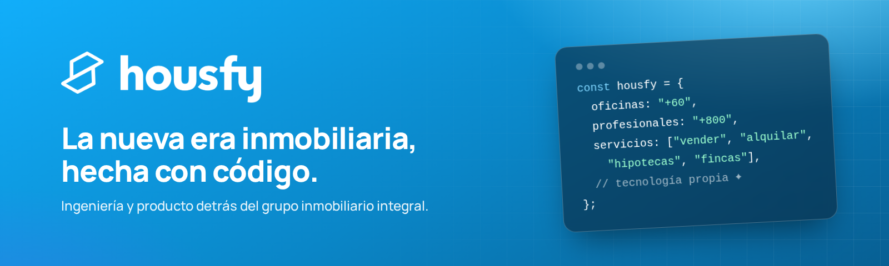

  

  
  
  

 

### 👋 Somos Housfy

El **grupo inmobiliario integral** que une el trato cercano de más de **800 profesionales** en **más de 60 oficinas** con **tecnología propia**. Desde 2017 construimos el producto que hace que vender, alquilar, conseguir una hipoteca o administrar una comunidad sea rápido, claro y transparente.

<table>
  <tr>
    <td width="33%" valign="top">
      <h4>🏠 Ecosistema</h4>
      Vender, alquilar, hipotecas, búsqueda de vivienda, administración de fincas y seguros del hogar. Un solo producto, seis servicios.
    </td>
    <td width="33%" valign="top">
      <h4>📱 MyHousfy</h4>
      El área privada donde cada cliente sigue en tiempo real su operación, su documentación y sus gestiones.
    </td>
    <td width="33%" valign="top">
      <h4>🤝 Híbrido</h4>
      No somos una inmobiliaria online: la tecnología da precisión y rapidez, y los expertos locales, cercanía.
    </td>
  </tr>
</table>

### 🛠️ Con qué construimos

  
  
  
  
  
  
  
  
  
  
  
  

### 🎓 Aprende con nosotros

Compartimos en abierto nuestras formaciones internas en **[housfy-slides](https://github.com/housfy/housfy-slides)**: IA para developers (Cursor, agents, MCPs) y fundamentos de desarrollo web.

→ **[Ver las slides](https://housfy.github.io/housfy-slides/)**

### 🔒 Seguridad

Nuestros correos oficiales terminan siempre en **@housfy.com** o **@housfypro.com**. Si has encontrado una vulnerabilidad o recibes algo sospechoso en nuestro nombre, escríbenos desde [housfy.com](https://housfy.com).

 

  
   
  Hecho con 💙 en Barcelona y Madrid

